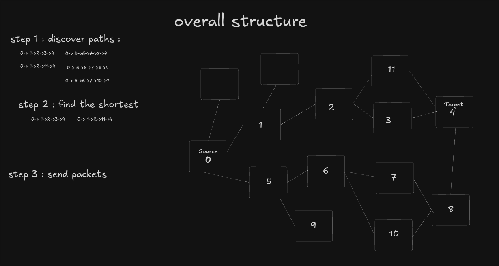
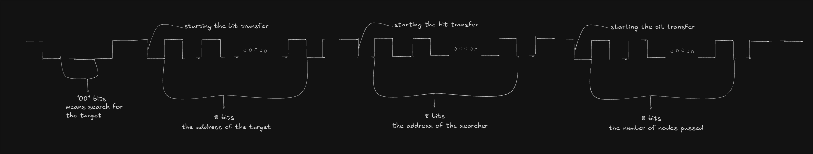
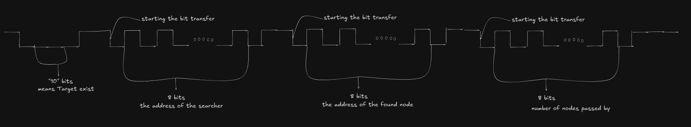
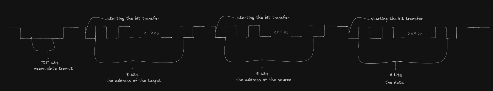
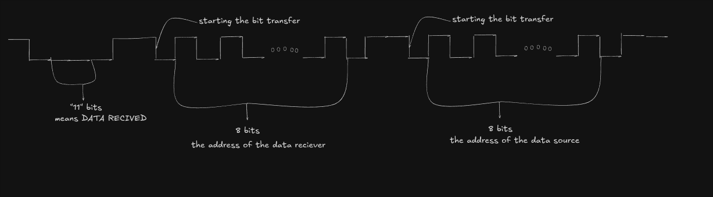

# Mesh Communication Protocol

A bare-metal mesh communication protocol for microcontrollers, where every node can talk to any other node in the network without Wi-Fi, CAN, or a shared bus — just GPIO.



## Overview

- A mesh network where every node is connected to up to 4 other nodes
- Every node has its own address
- Any node can communicate with any other node, even ones it isn't directly wired to — messages are routed hop by hop
- Nodes discover paths to each other dynamically and cache the shortest route once found, so they don't need to search again

## Packet Structure

Every packet is made up of 3 or 4 fields, sent as a sequence of edge-timed bits:

| Field | Size | Meaning |
|---|---|---|
| Mode | 2 bits | What the node is doing — searching, transiting data, etc. |
| Address 1 | 8 bits | Meaning depends on mode (see below) |
| Address 2 | 8 bits | Meaning depends on mode (see below) |
| Data | 8 bits | Payload, or metadata like hop count (present in most modes) |

There are 4 packet modes, distinguished by the 2-bit mode field.

### SEARCHING (code `00`)



- Address 1: target address
- Address 2: searcher's address
- Data: number of nodes passed through so far
- Whenever this packet passes through a node, that node broadcasts it out to every attached line except the one it came from, and saves the path back to the source so it doesn't need to search for it again

### TARGET_EXISTS (code `10`)



- Sent by the target back to the source, confirming it was found
- Address 1: source (who sent the original search request)
- Address 2: search target
- Data: number of nodes passed through

### DATA_TRANSIT (code `01`)



- Carries the actual payload
- Address 1: target address
- Address 2: source address
- Data: the payload byte

### DATA_RECEIVED (code `11`)



- Sent by the data receiver to confirm a `DATA_TRANSIT` packet arrived
- Only 3 fields: mode, receiver address, source address (no data field)

## Firmware Architecture

Bit reading is edge-triggered: each node's MCU has pins 1–4 on GPIOB wired to external interrupts, firing on rising or falling edges. Each interrupt routes to the bit-reading function for that pin, and context switches happen via a PendSV handler.

Each communication line (GPIO pin) owns its own state:

```c
typedef struct {
    communication_line_rx_param_t *params_rx;
    communication_line_tx_param_t *params_tx;
    thread_t *communication_thread;
    void (*writing_func)(void *);
} communication_line_t;
```

**RX state** (tied to GPIOB) tracks the current packet as it's decoded bit by bit, plus the last edge's timing and direction:

```c
typedef struct {
    uint8_t scratch_buffer;
    uint8_t mode_buffer;
    uint8_t finished_reading_mode;

    uint8_t data_buffer;
    uint8_t finished_reading_data;

    uint8_t address_buffer;
    uint8_t finished_reading_address;

    uint8_t address2_buffer;
    uint8_t finished_reading_address2;

    uint8_t pin;
    uint8_t recieved_bits;
    uint8_t sent_bits;
    int32_t last_falling_edge;
    int32_t last_rising_edge;
    last_edge_t last_edge;
    reading_t r;
    modes_t mode;

    void (*recived_data_intr)(void *);
    void *recived_data_intr_params;

    void (*data_handshake_intr)(void *);
    void *data_handshake_intr_params;

    void (*existing_target_intr)(void *);
    void *existing_target_intr_params;
} communication_line_rx_param_t;
```

**TX state** tracks the outgoing packet as it's being sent:

```c
typedef struct {
    uint8_t data_buffer;
    uint8_t address_buffer;
    uint8_t address2_buffer;
    uint8_t pin;
    uint8_t sent_bits;
    int32_t last_write_tick;
    sending_t s;
    modes_t s_mode;
} communication_line_tx_param_t;
```

Reading happens edge to edge, and each line runs as its own thread. Sending currently happens in a single blocking loop (not a busy-spin across the whole system, but blocking for that line) — moving packet transmission to be timer-tick-driven instead is a planned improvement.

## Hardware Notes

- Bit width is set by TIM2; each timer tick is 1 ms
- Every communication line must be pulled up to 3.3V

## Status

This firmware is not yet thoroughly tested — I don't currently have access to the full set of compatible hardware to validate multi-node behavior end to end. If you try it out on your own setup, I'd genuinely appreciate hearing how it goes, bug reports and notes included.